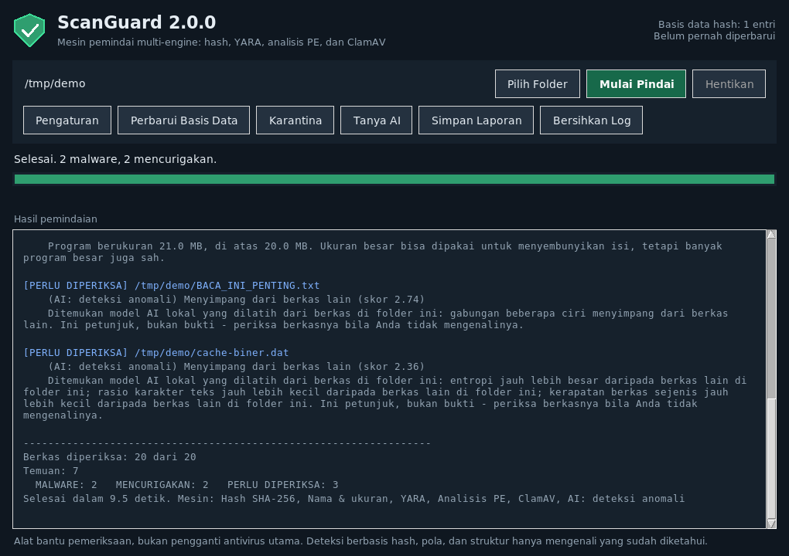
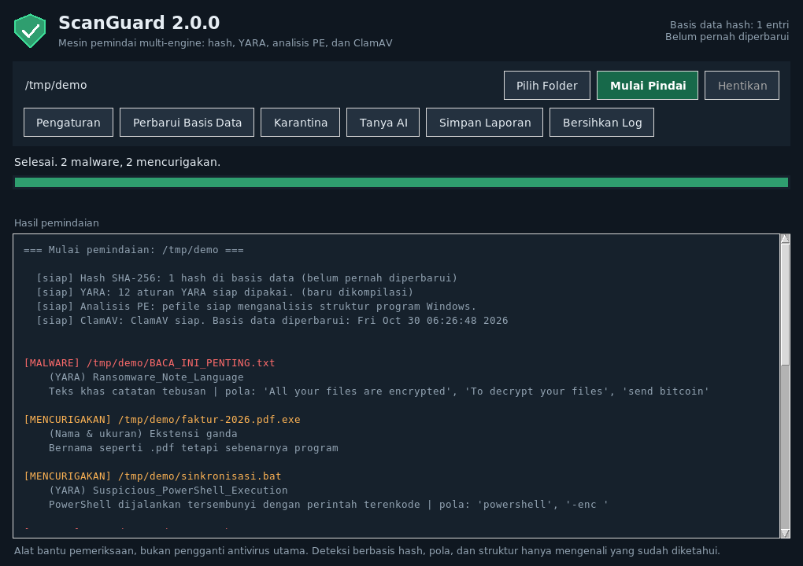
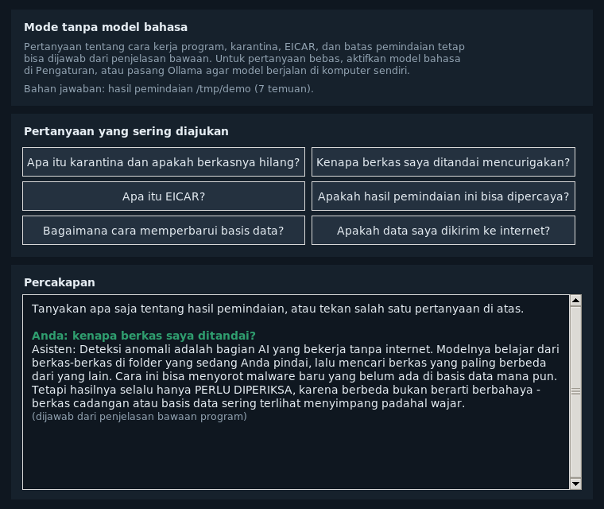
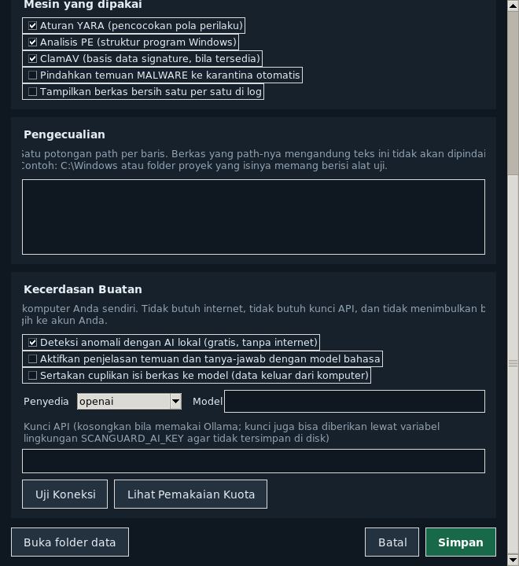

# ScanGuard 2.0 — antivirus berbasis GUI untuk Windows

Program pemindai malware dengan antarmuka grafis, ditulis dengan Python dan
tkinter, yang bisa dikompilasi menjadi satu file `.exe` lalu dibungkus menjadi
installer `setup.exe`.

Program ini **benar-benar memeriksa berkas**, memakai empat mesin deteksi ditambah
dua bagian kecerdasan buatan yang bekerja berdampingan:

| Mesin | Cara kerja | Butuh internet? |
|---|---|---|
| **Hash SHA-256 / SHA-1 / MD5** | Membandingkan sidik jari berkas dengan basis data malware yang sudah dikonfirmasi | Tidak (basis data bawaan); ya untuk memperbarui |
| **YARA** | Mencocokkan pola perilaku (12 aturan: EICAR, penghapusan shadow copy, PowerShell tersembunyi, pencuri kredensial, dan lainnya) | Tidak |
| **Analisis PE** | Membaca struktur program Windows: daftar impor, section, entropi, penanda pemadat | Tidak |
| **ClamAV** | Basis data tanda tangan virus sungguhan (108 MB, **lebih dari 3 juta tanda tangan** pada pengujian ini) | Tidak (opsional dipasang terpisah) |
| **AI: deteksi anomali** | Model dilatih di komputer Anda dari berkas di folder yang sedang dipindai, lalu mencari berkas yang menyimpang. Bisa menyorot malware baru yang belum ada di basis data mana pun. | **Tidak** |
| **AI: penjelasan temuan** | Model bahasa menjelaskan temuan dalam bahasa sehari-hari dan menjawab pertanyaan Anda. | Ya (kecuali Ollama) |

## Tangkapan layar

Semua gambar di bawah diambil dari program yang benar-benar berjalan. Folder
contohnya dibuat oleh `tools/make_demo_folder.py`, berisi berkas teks yang
kebetulan cocok dengan aturan YARA bawaan (bukan malware sungguhan), satu nama
berkas berkedok ganda, dan satu berkas program besar. Jadi warna MALWARE,
MENCURIGAKAN, dan PERLU DIPERIKSA di gambar muncul karena mesinnya memang
mendeteksi, bukan karena lognya disunting.

**Jendela utama setelah pemindaian.** Warna per tingkat bahaya, bilah kemajuan,
dan daftar mesin yang ikut bekerja:



**Bagian awal log** — nama mesin yang siap dipakai, termasuk deteksi anomali AI:



**Asisten AI**, menjawab pertanyaan tanpa kunci API sekalipun:



**Pengaturan**, bagian kecerdasan buatan:



## Baca ini lebih dulu: batas yang jujur

Ini **bukan** pengganti Windows Defender atau antivirus resmi. Empat mesin
pertama bekerja dengan cara yang sama: **mengenali apa yang sudah diketahui.**
Deteksi anomali bekerja dengan cara yang berbeda — ia mencari yang *janggal*,
bukan yang sudah tercatat — tetapi itu pun bukan bukti. Akibatnya:

- Malware **baru** yang belum pernah tercatat di basis data mana pun **tidak akan
  dikenali** oleh mesin-mesin yang mencocokkan tanda tangan. Ini berlaku juga
  untuk antivirus komersial, tetapi mereka menutupi celah itu dengan analisis
  perilaku, sandbox, dan telemetri dari jutaan komputer — hal-hal yang tidak
  dimiliki program ini. Deteksi anomali menutupi sebagian celah itu, dengan
  menandai berkas yang menyimpang dari sekitarnya.
- Program ini **tidak memantau berkas secara langsung** (tidak ada real-time
  protection). Ia memeriksa saat Anda menekan "Mulai Pindai".
- Program ini **tidak memblokir** apa pun. Ia melaporkan dan menawarkan
  karantina.
- **Tidak ada temuan bukan berarti berkas pasti aman.** Itu sebabnya laporan
  yang dihasilkan program ini selalu menyertakan keterbatasan ini di bagian
  bawah.
- **Deteksi anomali (AI) menemukan yang janggal, bukan yang terbukti jahat.**
  Hasilnya selalu berlabel PERLU DIPERIKSA, tidak pernah MALWARE, karena
  berbeda dari berkas lain bukan bukti kejahatan.

Pakai ScanGuard sebagai **pemeriksa tambahan**, bukan sebagai satu-satunya
pelindung. Kalau Anda hanya memasang satu alat keamanan di Windows, pakai
Windows Defender.

---

## 1. Menjalankan dari kode sumber

```bash
# 1. Pasang pustaka yang dibutuhkan
pip install -r requirements.txt

# 2. Periksa apakah semua mesin siap
python antivirus.py --cek-mesin

# 3. Jalankan programnya
python antivirus.py
```

Contoh keluaran `--cek-mesin`:

```
ScanGuard 2.0.0
Folder data : C:\Users\Anda\AppData\Local\ScanGuard
Berkas aturan: C:\...\rules\scanguard.yar

[siap] Hash SHA-256
          1 hash di basis data (belum pernah diperbarui)
[siap] YARA
          12 aturan YARA siap dipakai. (baru dikompilasi)
[siap] Analisis PE
          pefile siap menganalisis struktur program Windows.
[siap] ClamAV
          ClamAV siap. Basis data diperbarui: ...

[siap] AI: deteksi anomali
          Model lokal berjalan. Diuji pada 14 berkas serupa, 0 ditandai menyimpang.
[siap] AI: model bahasa
          Belum diaktifkan (OpenAI). Isi di Pengaturan > Kecerdasan Buatan,
          atau pakai Ollama agar model berjalan di komputer sendiri tanpa biaya.
```

Kalau ada mesin yang tertulis `TIDAK SIAP`, program tetap jalan — hanya
deteksinya berkurang. Keterangan penyebabnya tercetak tepat di bawahnya.

---

## 2. Cara memakai programnya

1. **Pilih Folder** — tentukan folder yang ingin diperiksa.
2. **Mulai Pindai** — pemindaian berjalan di latar belakang. Jendela tetap bisa
   digeser dan digulir selama proses berjalan; ini karena pemindaian berjalan di
   thread terpisah dan hasilnya dikirim ke jendela lewat antrean.
3. **Hentikan** — menghentikan pemindaian dengan rapi (berkas yang sedang
   diperiksa diselesaikan lebih dulu).
4. Setelah selesai, program menawarkan memindahkan temuan **MALWARE** ke
   **karantina**. Isi berkas yang dikarantina diacak sehingga tidak bisa
   dijalankan, tetapi masih bisa dipulihkan utuh kapan saja.
5. **Simpan Laporan** — menyimpan hasil lengkap ke berkas teks, termasuk hash
   dan daftar mesin yang menemukan apa.
6. **Tanya AI** — membuka jendela asisten: tanyakan kenapa sebuah berkas
   ditandai, apa arti sebuah temuan, atau apa yang sebaiknya dilakukan.
   Tanpa kunci API ia menjawab dari penjelasan bawaan program; dengan kunci API
   pertanyaan bebas diteruskan ke model. Rinciannya di bagian 6.

### Tiga tingkat temuan

| Tingkat | Artinya | Contoh |
|---|---|---|
| **MALWARE** | Bukti kuat. Hash cocok basis data, atau YARA menemukan pola yang jelas berbahaya, atau ClamAV mengenali tanda tangan virus. | EICAR, penghapusan shadow copy, impor penyuntikan kode |
| **MENCURIGAKAN** | Pola yang lazim pada malware, tetapi bisa juga muncul di program sah. | Ekstensi ganda (`Faktur.pdf.exe`), impor mencurigakan dalam jumlah sedang |
| **PERLU DIPERIKSA** | Petunjuk lemah. Hanya muncul bila terkumpul cukup banyak. | Section yang bisa ditulis sekaligus dijalankan, program berukuran tidak wajar, berkas yang menyimpang dari sekitarnya (AI) |

Tingkat dipisahkan seperti ini dengan sengaja. Alat yang menuduh semua hal
sebagai virus akan diabaikan penggunanya, dan alat yang diabaikan sama saja
dengan tidak ada.

---

## 3. Memperbarui basis data hash

Program ini hanya membawa **satu** hash bawaan (EICAR, berkas uji standar
industri antivirus). Tanpa pembaruan, mesin hash praktis tidak berguna.

Buka **Perbarui Basis Data**, lalu pilih salah satu:

| Cara | Butuh kunci? | Keterangan |
|---|---|---|
| **Ambil dari MalwareBazaar** | Ya | Basis data malware terbesar yang terbuka. Sejak 30 Juni 2025 abuse.ch mewajibkan **Auth-Key**. Buat gratis di <https://auth.abuse.ch/> lalu isikan di **Pengaturan**. |
| **Impor berkas CSV/TXT** | Tidak | Satu hash per baris, atau format CSV `hash,nama,jenis`. Baris diawali `#` diabaikan. Cocok untuk daftar hash internal organisasi. |
| **Unduh dari URL** | Tidak | Sama seperti impor berkas, tetapi diambil dari alamat web. |

Kunci API disimpan di `settings.json` di dalam folder data pengguna dengan izin
baca terbatas, **bukan** di dalam kode program, dan tidak pernah ditulis ke log.

---

## 4. Mengubah skrip Python menjadi `.exe`

Bagian ini yang paling sering gagal di proyek sejenis, jadi dibahas sampai ke
penyebabnya.

### 4.1 Cara cepat (Windows)

```
build_exe.bat
```

Skrip itu memasang kebutuhan, membuat ikon, lalu mengompilasi. Hasilnya:
`dist\ScanGuard.exe`. Ukuran yang terukur pada pengujian Linux: **16,5 MB**
(build Windows biasanya sedikit lebih besar). Komponen terbesarnya adalah
`libcrypto` yang dibawa yara-python, pustaka Python, dan pustaka Tcl/Tk. Bagian
AI hanya menambah sekitar 0,1 MB, karena model anomali dihitung sendiri dan
pemanggilan model bahasa memakai `urllib` dari pustaka standar.

### 4.2 Perintah manualnya

```bat
python -m pip install -r requirements.txt
python -m PyInstaller --noconfirm --clean ScanGuard.spec
```

Atau tanpa berkas `.spec`:

```bat
python -m PyInstaller --onefile --windowed --name ScanGuard ^
    --icon assets\icon.ico ^
    --add-data "assets;assets" ^
    --add-data "rules;rules" ^
    --hidden-import yara ^
    --hidden-import pefile ^
    antivirus.py
```

### 4.3 Empat hal yang harus benar

**1. `--hidden-import yara` dan `--hidden-import pefile` wajib.**

Ini penyebab kegagalan yang paling berbahaya, karena **tidak memunculkan pesan
error apa pun**. Kedua pustaka itu diimpor di dalam fungsi, bukan di bagian atas
berkas, sehingga PyInstaller tidak bisa menemukannya lewat analisis impor
biasa. Tanpa baris itu, `.exe` tetap terbentuk dan tetap bisa dibuka — hanya saja
dua mesin terkuatnya diam-diam tidak aktif. Program akan melaporkan "tidak ada
temuan" pada berkas yang seharusnya dikenali.

Cara memastikannya:

```
ScanGuard.exe --cek-mesin
```

**2. Folder `rules` harus ikut disalin.**

Aturan YARA dibaca dari berkas saat program dijalankan. Tanpa
`--add-data "rules;rules"`, mesin YARA akan melaporkan berkas aturan tidak
ditemukan.

**3. `--windowed` supaya tidak ada jendela hitam.**

Tanpa ini, jendela Command Prompt ikut terbuka di belakang aplikasi GUI.

**4. UPX harus dimatikan.**

Pemadatan UPX membuat `.exe` hasil PyInstaller sering **dituduh virus oleh
antivirus lain**. Anda lalu menghadapi situasi yang merepotkan: program buatan
Anda sendiri dianggap malware oleh Windows Defender di komputer orang lain.
Berkas `ScanGuard.spec` sudah mematikan UPX (`upx=False`).

### 4.4 Memastikan hasil build benar

```bat
dist\ScanGuard.exe --cek-mesin
```

Semua mesin harus tertulis `siap`. Kalau YARA tertulis `TIDAK SIAP`, berarti
pustaka `yara` tidak ikut terbungkus — periksa kembali langkah 4.3 nomor 1.
Bagian "AI: model bahasa" boleh tertulis belum diaktifkan: itu memang fitur
opsional yang bawaannya mati, bukan tanda ada yang rusak.

### 4.5 Kalau `.exe` dianggap virus

Windows Defender kadang menandai berkas hasil PyInstaller. Ini masalah yang
diketahui dan bukan tanda program Anda berbahaya:

- Pastikan UPX dimatikan (langkah 4.3 nomor 4).
- Berkas yang baru dibuat dari nol memang belum punya reputasi.
- Untuk distribusi serius, `.exe` perlu **ditandatangani secara digital**
  (code signing certificate). Tanpa tanda tangan, setiap pengguna baru akan
  melihat peringatan SmartScreen. Sertifikat ini berbayar dan diterbitkan oleh
  otoritas sertifikat — tidak ada cara gratis untuk menghindarinya.

---

## 5. Membungkus `.exe` menjadi installer `setup.exe`

### 5.1 Dengan Inno Setup (gratis, disarankan)

1. Unduh Inno Setup 6.3 atau lebih baru dari <https://jrsoftware.org/isdl.php>
   lalu pasang.
2. Jalankan `build_exe.bat` sampai muncul `dist\ScanGuard.exe`.
3. Jalankan `build_installer.bat`, atau buka `installer\ScanGuard.iss` di Inno
   Setup Compiler lalu tekan **F9**.
4. Hasilnya: `installer\Output\ScanGuard-Setup-2.0.0.exe`

Satu berkas itu yang Anda kirim ke pengguna. Cukup klik dua kali untuk memasang.

**Yang dilakukan installer ini:**

- Memasang ke folder milik pengguna (`{localappdata}\Programs\ScanGuard`),
  sehingga **tidak muncul layar UAC** dan tidak butuh hak administrator.
- Membuat pintasan di Start Menu dan (opsional) di Desktop.
- Mendaftarkan entri uninstall di *Apps & features*.
- Menawarkan menjalankan program setelah pemasangan selesai.
- Menyediakan centang opsional untuk menjalankan `--cek-mesin`, supaya pengguna
  bisa memastikan mesin deteksi aktif di komputernya.
- Saat uninstall, **hanya folder aplikasi yang dihapus**. Folder data pengguna
  (`%LOCALAPPDATA%\ScanGuard`) sengaja dibiarkan, karena di dalamnya ada
  karantina. Kalau ikut terhapus, berkas yang dikarantina hilang tanpa
  sepengetahuan pengguna.

**Kalau memakai skrip `.iss` ini untuk program lain**, ganti `AppName`,
`AppVersion`, `AppPublisher`, dan **buat GUID baru** untuk `AppId` (menu
*Tools → Generate GUID*). Dua program dengan `AppId` sama akan saling menimpa
saat dipasang.

### 5.2 Dengan Advanced Installer

1. Unduh Advanced Installer (versi gratis *Freeware* cukup untuk ini) dari
   <https://www.advancedinstaller.com/download.html>.
2. **New Project → Simple**.
3. Product Name: `ScanGuard`; Product Version: `2.0.0`.
4. **Install Parameters** → *Installation Path*: pilih
   `Program Files` **atau** *Per-User* (`%LOCALAPPDATA%`) agar tidak butuh UAC.
5. Tab **Files and Folders** → **Application Folder** → *Add Files* →
   pilih `dist\ScanGuard.exe`.
6. Buat pintasan: klik kanan berkas → *New Shortcut to* → **Start Menu** →
   *Program Menu* → `ScanGuard`.
7. **Build** → *Build* → hasilnya di folder `Setup Files`.
8. Agar tanda tangan digital diterapkan, isi **Digital Signature** sebelum
   build. Tanpa itu, Windows SmartScreen akan memperingatkan pengguna.

---

## 6. Kemampuan AI

Ada **dua** bagian AI di ScanGuard, dan keduanya sangat berbeda sifatnya. Perbedaan
ini penting supaya Anda tidak salah harap.

### 6.1 Deteksi anomali — bekerja langsung, tanpa kunci, tanpa internet

Ini bagian AI yang paling berguna untuk keamanan, dan **sudah menyala begitu
program dijalankan**. Tidak perlu mendaftar di mana pun, tidak perlu kunci API,
tidak ada biaya.

**Masalah yang dipecahkan.** Semua mesin lain mengenali *yang sudah diketahui*:
hash yang tercatat, pola yang sudah ditulis, tanda tangan yang sudah dibuat.
Malware yang baru dibuat tidak dikenali oleh satu pun dari mereka.

**Cara kerjanya.** ScanGuard mengumpulkan ciri setiap berkas di folder yang
sedang dipindai — ukuran, entropi, apakah berkas program, rasio karakter teks,
kedalaman folder, dan kerapatan berkas sejenis. Lalu ia mencari berkas yang
**menyimpang jauh** dari kumpulan itu memakai analisis komponen utama (PCA).
Malware yang disisipkan ke folder dokumen biasanya tampak janggal dibanding
tetangga-tetangganya.

Modelnya sederhana dan memang sengaja begitu. Enam ciri dan dua komponen utama
dihitung dengan pustaka standar Python — tidak ada numpy, tidak ada model
terlatih berukuran ratusan MB, dan tidak ada yang perlu diunduh. Untuk mencari
penyimpangan dalam satu folder, itu sudah cukup.

```
31 berkas, 1 anomali ditemukan:
  skor=5.48  aneh.exe
      - ukuran jauh lebih besar daripada berkas lain di folder ini
      - entropi jauh lebih besar daripada berkas lain di folder ini
      - jenis program jauh lebih besar daripada berkas lain di folder ini
```

**Batas yang harus jujur disebut.** Anomali bukan bukti kejahatan. Berkas
cadangan, basis data, dan berkas terenkripsi milik Anda sendiri sering terlihat
menyimpang padahal wajar. Karena itu hasilnya **selalu** berlabel PERLU
DIPERIKSA, tidak pernah MALWARE, dan selalu disertai alasan mengapa berkas itu
dianggap menyimpang. Di folder dengan kurang dari 12 berkas, modelnya tidak
dijalankan sama sekali — mencari penyimpangan dari kelompok sekecil itu hanya
menghasilkan kebisingan.

### 6.2 Penjelasan temuan dan tanya-jawab — opsional

Buka tombol **Tanya AI**. Jendelanya punya dua lapis, dan lapis pertama selalu
bekerja:

| Lapis | Kapan dipakai | Butuh kunci API? |
|---|---|---|
| **Pengetahuan bawaan** | Pertanyaan umum: apa itu karantina, kenapa berkas ditandai, apakah hasil ini bisa dipercaya, apa itu EICAR, dan seterusnya (14 topik) | Tidak |
| **Model bahasa** | Pertanyaan bebas yang tidak ada di daftar bawaan, dan penjelasan satu berkas tertentu | Ya (kecuali Ollama) |

Lapis pertama ada dengan sengaja. Fitur AI yang baru berguna setelah pengguna
mendaftar dan membayar kunci API jarang dipakai. Dengan dua lapis, asisten ini
berguna sejak detik pertama program dibuka.

**Tiga cara memakai model bahasa:**

| Penyedia | Biaya | Keterangan |
|---|---|---|
| **Ollama** | Gratis | Model berjalan di komputer Anda sendiri. Pasang dari <https://ollama.com>, jalankan `ollama pull llama3.2`, lalu pilih Ollama di Pengaturan. **Tidak ada data yang keluar dari komputer.** |
| **OpenAI** | Berbayar | Isi kunci API di Pengaturan. Bawaannya model `gpt-4o-mini`. |
| **Anthropic** | Berbayar | Isi kunci API di Pengaturan. Bawaannya model `claude-3-5-haiku-latest`. |

Penyedia yang memakai bentuk API OpenAI (termasuk server perusahaan Anda sendiri)
juga bisa dipakai: pilih OpenAI, lalu isi alamat API-nya.

**Yang mengendalikan biaya Anda:**

- Fitur berbayar **mati secara bawaan**. Anda yang menyalakannya.
- Hasil analisis disimpan di cache berdasarkan **hash berkas**. Bertanya ulang
  tentang berkas yang sama tidak memanggil model lagi.
- Isi berkas **tidak ikut** dikirim. Yang dikirim hanya nama, ukuran, hash, dan
  jenis temuan. Cuplikan isi berkas hanya ikut bila Anda sendiri menyalakan
  pilihan itu di Pengaturan.
- Nama pengguna Windows, alamat email, nomor telepon, dan alamat IP **diganti
  lebih dulu**. Path `C:\Users\Budi\...` berubah menjadi
  `C:\Users\<pengguna>\...`.
- Pemakaian kuota bisa dilihat di Pengaturan > Lihat Pemakaian Kuota.

### 6.3 Satu hal yang AI **tidak** boleh lakukan

**AI tidak pernah menentukan tingkat bahaya.** Tingkat MALWARE / MENCURIGAKAN /
PERLU DIPERIKSA hanya boleh datang dari mesin deteksi yang hasilnya bisa
diperiksa ulang: hash yang cocok, aturan YARA, struktur PE, tanda tangan ClamAV.

Alasannya: model bahasa bisa salah dengan sangat percaya diri. Kalau ia
diizinkan menuduh, pengguna akan menerima tuduhan berat yang tidak bisa
diperiksa ulang — dan itu lebih buruk daripada tidak ada tuduhan sama sekali.
Peran yang diberikan ke model secara tegas melarangnya menentukan tingkat
bahaya. Batasan itu ikut diuji, bukan hanya ditulis di komentar.

## 7. Isi proyek

```
project/
├── antivirus.py               ← titik masuk; tipis, hanya memanggil GUI
├── scanguard/                 ← seluruh logika program
│   ├── config.py              ← konstanta, lokasi data, lokasi aset
│   ├── core.py                ← struktur data, hash, entropi, ukuran
│   ├── hashes.py              ← basis data hash SQLite + pembaruannya
│   ├── yara_engine.py         ← mesin YARA (dengan cache kompilasi aturan)
│   ├── pe_engine.py           ← analisis struktur program Windows
│   ├── clamav_engine.py       ← pembungkus clamscan (mode batch)
│   ├── quarantine.py          ← karantina aman + pemulihan byte-identik
│   ├── scanner.py             ← orkestrator keempat mesin
│   ├── report.py              ← penyusun laporan teks
│   ├── settings.py            ← pengaturan pengguna (JSON, izin terbatas)
│   ├── dialogs.py             ← jendela pengaturan, pembaruan, karantina, asisten
│   ├── ai/                    ← bagian kecerdasan buatan
│   │   ├── base.py            ← pintu tunggal ke model bahasa (3 penyedia)
│   │   ├── anomaly.py         ← deteksi anomali lokal (PCA, tanpa internet)
│   │   ├── analyst.py         ← penjelasan temuan
│   │   ├── assistant.py       ← tanya-jawab: pengetahuan bawaan + model
│   │   ├── cache.py           ← cache hasil AI dan catatan pemakaian kuota
│   │   └── privacy.py         ← penyamaran data pribadi sebelum dikirim
│   └── gui.py                 ← antarmuka utama tkinter
├── rules/scanguard.yar        ← 12 aturan YARA
├── assets/                    ← ikon aplikasi
├── tests/
│   ├── fixtures.py            ← pembuat berkas PE untuk pengujian
│   ├── test_core.py           ← 133 pengujian mesin dan antarmuka
│   └── test_ai.py             ← 88 pengujian bagian AI
├── docs/                      ← gambar untuk README
├── tools/                     ← skrip bantu (ikon, folder contoh, tangkapan layar)
├── installer/ScanGuard.iss    ← skrip Inno Setup
├── ScanGuard.spec             ← konfigurasi PyInstaller
├── build_exe.bat              ← Python → .exe
├── build_installer.bat        ← .exe → setup.exe
├── requirements.txt
└── run_tests.sh
```

### Membuat ulang tangkapan layar

Gambar di README dibuat oleh dua skrip bantu, bukan diambil dengan tangan:

```bash
python3 tools/make_demo_folder.py /tmp/demo
xvfb-run -a --server-args="-screen 0 1100x780x24" \
    python3 tools/screenshot.py /tmp/demo docs
```

Skrip pertama membuat folder contoh yang memicu ketiga tingkat bahaya. Skrip
kedua menjalankan GUI sungguhan, memindai folder itu, lalu menyimpan empat
gambar ke `docs/`. Skrip kedua juga mencetak pemeriksaan tata letak: apakah
tombol terpotong, apakah setiap warna tingkat bahaya benar-benar muncul di
layar (dihitung dari piksel), dan apakah ada gambar yang nyaris satu warna
(tanda jendela gagal tergambar).

## 8. Menjalankan pengujian

```bash
./run_tests.sh

# Di server tanpa layar, pengujian antarmuka butuh layar maya:
xvfb-run -a ./run_tests.sh
```

221 pengujian, mencakup keenam mesin, karantina, orkestrator, laporan,
pengaturan, bagian AI, tata letak antarmuka, kontras warna (dihitung sebagai
angka WCAG, bukan dinilai dari gambar), dan berkas build. Pengujian yang memerlukan ClamAV
dilewati otomatis bila ClamAV tidak terpasang.

Pengujian memakai berkas sungguhan, bukan tiruan: basis data SQLite sungguhan,
berkas PE sungguhan (dibuat langsung dari struktur biner oleh
`tests/fixtures.py`), karantina sungguhan, dan proses `clamscan` sungguhan.
Yang diganti hanya kotak dialog modal dan kecepatan waktu, karena keduanya tidak
bisa dipakai di lingkungan tanpa layar.

## 9. Bagaimana bagian yang sulit dikerjakan

**Jendela tidak boleh membeku.** Pemindaian berjalan di thread pekerja, dan
thread itu **tidak pernah menyentuh widget tkinter**. Ia hanya menaruh kejadian
ke `queue.Queue`; main thread mengosongkan antrean itu 12 kali per detik lewat
`root.after()`. Melanggar aturan ini membuat jendela membeku atau program mati
dengan error dari dalam Tk. Pengujiannya menghitung berapa kali main thread
sempat melayani jendela selama pemindaian — bukan sekadar memeriksa bahwa
program tidak crash.

**Hasil pemindaian ulang harus sama.** Basis data cache menyimpan **temuan**,
bukan hanya kesimpulan. Versi awal hanya menyimpan kesimpulan, sehingga
pemindaian ulang yang memakai cache melaporkan malware jauh lebih sedikit —
hasilnya berubah hanya karena berkasnya tidak berubah. Sekarang pemindaian
pertama dan berikutnya menghasilkan daftar temuan yang identik, dan itu diuji
secara langsung.

**Tingkat bahaya tidak boleh asal.** Setiap mesin memberi nilai; bukti kuat
(hash cocok, tanda tangan virus) langsung menjadi MALWARE, sedangkan bukti lemah
hanya bisa menjadi catatan bila terkumpul cukup banyak. Angka ambangnya dipilih
dari hasil pengujian terhadap program Windows normal — program bersih yang
mengimpor 25 fungsi lazim tidak dilaporkan sama sekali.

**Deteksi anomali memakai PCA yang ditulis sendiri, bukan numpy.** Modelnya
dihitung dengan iterasi pangkat (power iteration) untuk mencari dua komponen
utama. Menambahkan numpy akan menambah belasan MB ke `.exe` hanya untuk enam
ciri — tidak sebanding. Yang harus dijaga: pembagian dengan simpangan baku nol
saat semua berkas identik, dan penskalaan ciri. Tanpa penskalaan, ciri "ukuran"
(dalam jutaan) menenggelamkan ciri "jenis program" (0 atau 1), sehingga model
hanya melihat ukuran — kesalahan paling umum saat memakai PCA.

**Batasan AI diuji, bukan hanya ditulis.** Ada pengujian yang memeriksa bahwa
`anomaly.py` tidak memuat `SEV_MALWARE` sama sekali, sehingga tidak ada jalan
bagi AI untuk menuduh malware. Ada juga pengujian yang memeriksa bahwa larangan
itu benar-benar terkirim ke penyedia AI — bukan hanya ada di dalam kode.

**Warna antarmuka diuji sebagai angka.** Setiap pasangan teks/latar dihitung
rasio kontras WCAG-nya dan harus lolos 4,5:1. Ini deterministik dan tidak
bergantung pada font yang terpasang, jadi hasilnya sama di komputer mana pun.

Ini menangkap masalah yang tidak terlihat dengan mata. Warna aksen hijau yang
dipakai untuk ikon perisai (`#2f9e6f`) hanya mencapai **3,36:1** dengan teks
putih — gagal sebagai isian tombol. Karena itu tombol utama memakai hijau yang
lebih gelap (`#17694a`, **6,65:1**), dan warna aksen yang lebih terang tetap
dipakai hanya sebagai isian ikon, bukan sebagai latar teks. Satu warna tidak
bisa dipakai untuk keduanya.

## 10. Lisensi dan penggunaan

Proyek edukasi. Pindai hanya folder milik Anda sendiri. Program ini tidak
mengunggah berkas apa pun ke internet; permintaan jaringan hanya dilakukan saat
Anda secara sadar menekan tombol pembaruan basis data.
